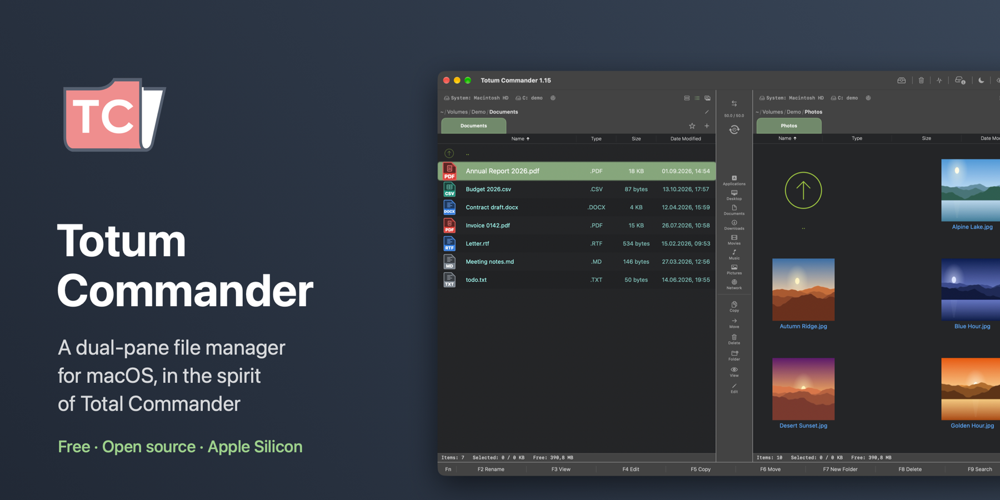
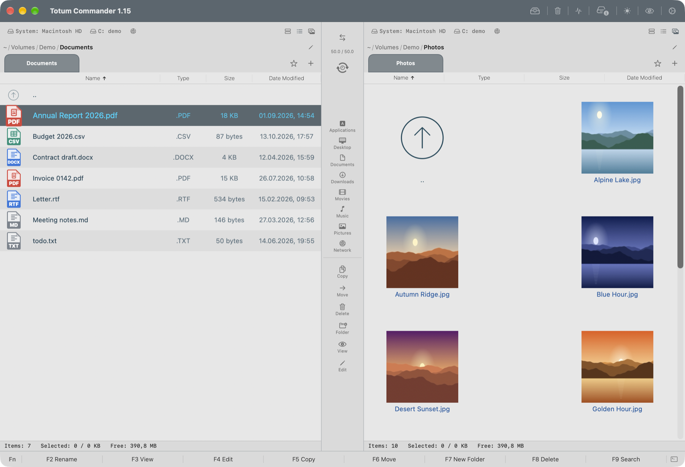
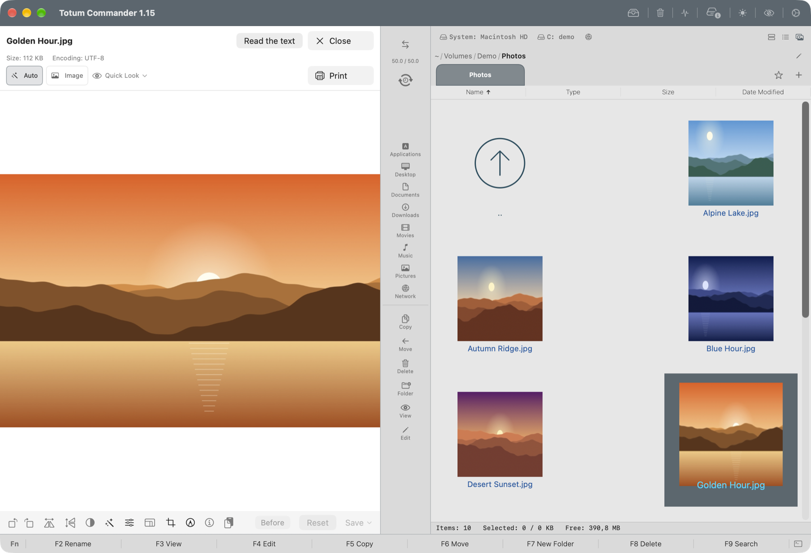
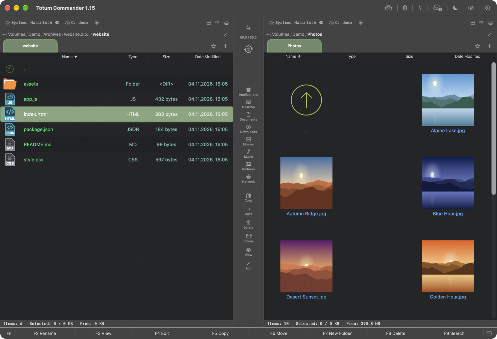

# Totum Commander

[](https://github.com/Toys-D/TotumCommander/releases/latest)


[](LICENSE)

A dual-pane file manager for macOS in the spirit of Total Commander. A C++20 core with a SwiftUI and AppKit interface, built for people who live in their file manager.

**[Download the latest release](https://github.com/Toys-D/TotumCommander/releases/latest)** · macOS 15 (Sequoia) or newer · Apple Silicon · free and open source



<picture>
  <source media="(prefers-color-scheme: dark)" srcset=".github/screenshots/main-dark.png">
  
</picture>

| | |
|:---:|:---:|
|  |  |
| **The viewer:** pictures, text, PDF, audio and video, quick image fixes | **Archives as folders:** walk into a zip as into any folder |

## Feels like Total Commander

The keys you already know: **F3** view, **F4** edit, **F5** copy, **F6** move, **F7** new folder, **F8** delete, **Tab** to the other panel, **Ctrl+B** for every file of a branch in one list. Built-in key sets of Total Commander and Midnight Commander, or your own. Marking by mask, a quick filter, the cursor that stays where you left it.

## What it does

- **Two panels, done properly.** Tabs with pinning and colours, a file shelf for gathering files across folders, history and bookmarks, a quick filter by mask, marking by mask the Total Commander way.
- **File operations you can trust.** Copy and move with an operation queue, batch rename, undo for file operations (Cmd+Z), a Trash with restore, folder rules that sort files for you.
- **Archives as folders.** zip, 7z, tar with every compression (gzip, bzip2, xz, zstd, lzip, lz4), rar (read), iso. Create, add, delete, test integrity, AES-256 password zips.
- **Disk images and vaults.** Mount images straight from the panel; encrypted vaults (sparsebundle, AES-256) open with Touch ID and lock back into a single file.
- **Network.** SMB, AFP, FTP, SFTP, WebDAV, cloud storage through rclone (Google Drive, Dropbox, OneDrive, S3 and more), a browser for the local network.
- **A viewer for nearly everything.** Text and code, Markdown, PDF with bookmarks, DjVu, images, video and audio (WMA, APE, RealAudio and DTS too), PostScript and EPS, DXF drawings, e-books.
- **Editor and terminal.** An embedded code editor, a terminal in the panel, an external editor of your choice.
- **Search.** By name and content, Spotlight, a duplicate finder, Unicode-aware for every language.
- **Git marks** in the file list, colour rules for files, Finder tags.
- **NTFS** read and write.
- **Your look.** Dark and light themes, custom interface colours that keep text readable, a configurable toolbar and context menu, its own set of controls.
- **Languages.** English and Russian, the interface and the built-in help alike. It follows your Mac's language; to switch, go to **Settings ▸ General ▸ Application language**.

## Install

1. Download the DMG from the [releases page](https://github.com/Toys-D/TotumCommander/releases/latest) and drag **Totum Commander** into Applications.
2. The app carries no Apple certificate, so macOS refuses the first launch. Open it once with **right-click ▸ Open** and confirm. On macOS 15, after the first attempt go to **System Settings ▸ Privacy & Security** and press **Open Anyway**.

From then on it opens like any other app.

## Build from source

Requires Xcode 16+, CMake 3.25+, and from Homebrew: `libarchive`, `libssh2`, `djvulibre`, `ghostscript`, `dylibbundler`.

```bash
bash scripts/launch.sh
```

Builds the Swift package, assembles `Totum Commander.app` and launches it. A release DMG: `bash scripts/release.sh`, the result lands in `dist/`.

Tests: `swift test` for the Swift side, `bash scripts/run_tests.sh` for the core.

## Support the project

Totum Commander is free and open source. I build it alone, in my spare time, because the Mac deserves a file manager of Total Commander's calibre. If it saves you time, support it: that is what lets me spend more of mine on it.

**[Support via PayPal](https://www.paypal.com/cgi-bin/webscr?cmd=_xclick&business=pixmap1981%40gmail.com&item_name=Totum+Commander&currency_code=USD)** · Support is voluntary; nothing in the program depends on it.

## Get in touch

Bugs, questions, wishes: **[pixmap1981@gmail.com](mailto:pixmap1981@gmail.com?subject=Totum%20Commander)**, or open an [issue](https://github.com/Toys-D/TotumCommander/issues).

## License

Copyright © 2026 Pixmap Labs.

GNU GPL v3, see [LICENSE](LICENSE). The app bundles third-party components: rclone (MIT), Ghostscript (AGPL v3), DjVuLibre (GPL v2+), ntfs-3g (GPL v2+), libarchive, minizip-ng, libssh2, OpenSSL and others. Their licence texts ship inside the app in `Contents/Resources/Licenses`.

---

## По-русски

Двухпанельный файловый менеджер для macOS в духе Total Commander: своё ядро на C++20, интерфейс на SwiftUI и AppKit.

**[Скачать последнюю версию](https://github.com/Toys-D/TotumCommander/releases/latest)** · macOS 15 (Sequoia) и новее, Apple Silicon · бесплатно и с открытым кодом.

Клавиши как в Total Commander: **F3** просмотр, **F4** правка, **F5** копировать, **F6** перенести, **F7** новая папка, **F8** удалить, **Tab** в другую панель, **Ctrl+B** — все файлы ветки одним списком. Встроенные наборы клавиш Total Commander и Midnight Commander или свой.

Две панели с вкладками и полкой, очередь операций, переименование группой, Cmd+Z для файловых операций, Корзина с восстановлением; архивы как папки (zip, 7z, tar со всеми сжатиями, rar, iso); образы дисков и зашифрованные хранилища; сеть SMB, AFP, FTP, SFTP, WebDAV и облака через rclone; просмотрщик текста, Markdown, PDF, DjVu, изображений, видео и звука (в том числе WMA, APE, RealAudio, DTS), PostScript, DXF и книг; встроенный редактор и терминал; поиск по имени и содержимому; Git-пометки, цветовые правила, NTFS на чтение и запись; тёмная и светлая темы.

**Языки:** русский и английский — и интерфейс, и встроенная справка. Программа берёт язык системы, переключить можно в **Настройки ▸ Основные ▸ Язык приложения**.

**Установка.** Перетащите программу из DMG в «Программы». Она подписана без сертификата Apple, поэтому в первый раз откройте её через **правый щелчок ▸ Открыть**; на macOS 15 после первой попытки зайдите в **Системные настройки ▸ Конфиденциальность и безопасность** и нажмите **«Всё равно открыть»**.

**Сборка из исходников:** Xcode 16+, CMake 3.25+, из Homebrew `libarchive`, `libssh2`, `djvulibre`, `ghostscript`, `dylibbundler`; затем `bash scripts/launch.sh`. Релизный DMG: `bash scripts/release.sh`.

**Поддержать.** Программа бесплатная и с открытым кодом, я делаю её один, в свободное время. Если она экономит вам время, **[поддержите через PayPal](https://www.paypal.com/cgi-bin/webscr?cmd=_xclick&business=pixmap1981%40gmail.com&item_name=Totum+Commander&currency_code=USD)**. Поддержка добровольная, ничего в программе от неё не зависит.

**Связь.** Ошибки, вопросы, пожелания: **[pixmap1981@gmail.com](mailto:pixmap1981@gmail.com?subject=Totum%20Commander)** или [issue на GitHub](https://github.com/Toys-D/TotumCommander/issues).

**Лицензия:** © 2026 Pixmap Labs, GNU GPL v3. Тексты лицензий встроенных компонентов лежат в `Contents/Resources/Licenses` внутри программы.
